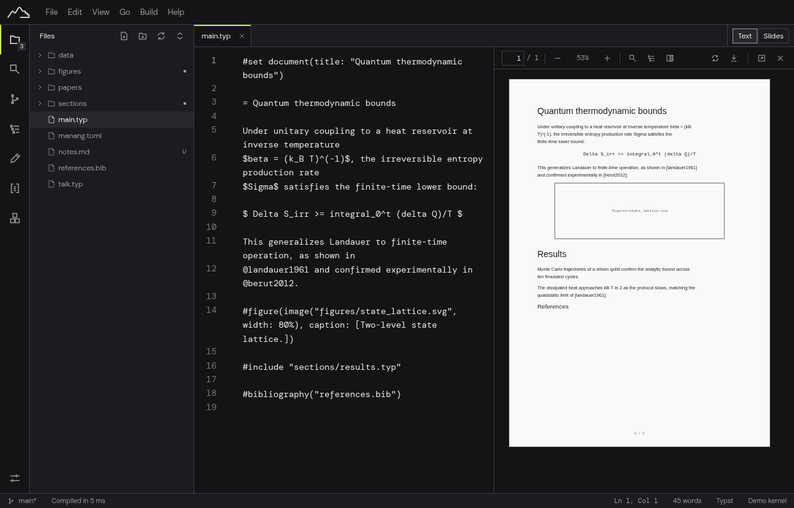
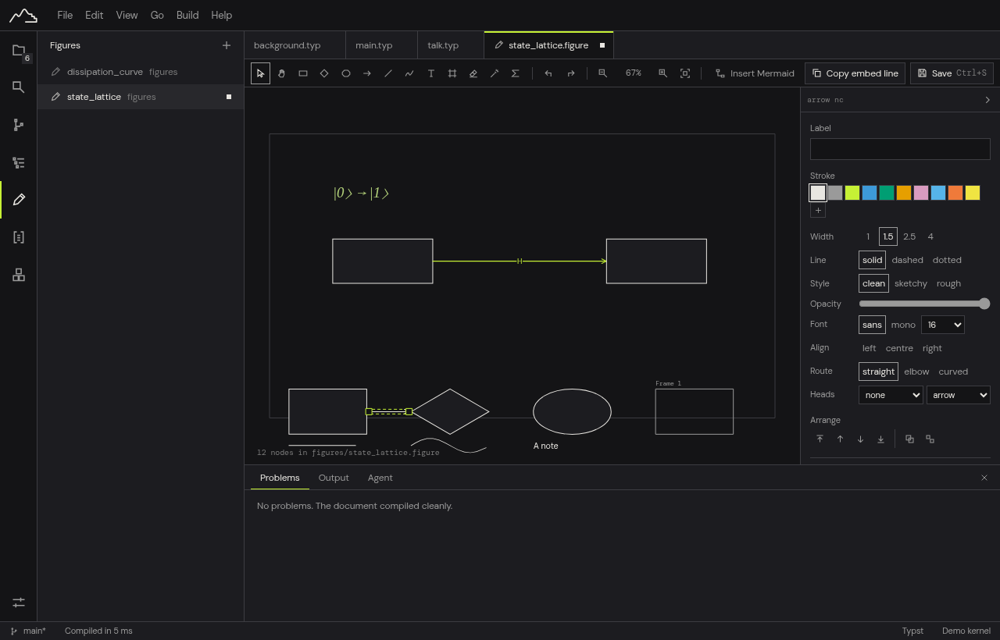
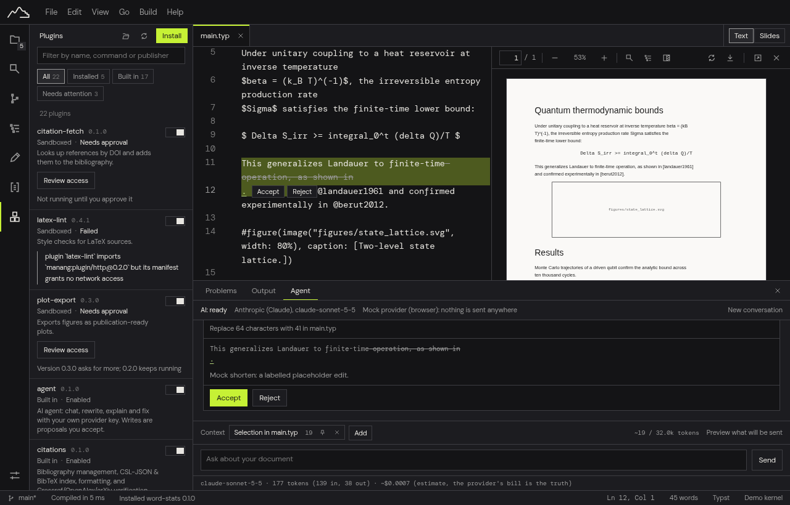

<h1 align="center">Manang</h1>

<p align="center">
  <strong>Write papers, theses and slides in Typst, LaTeX or Markdown. Draw the figures too.<br>
  Fast, local-first, with AI that only proposes and live co-editing that stays private.</strong>
</p>

<p align="center">
  <a href="docs/user/index.md">User guide</a> ·
  <a href="docs/plugins.md">Plugins</a> ·
  <a href="docs/beta/tester-guide.md">Beta tester guide</a> ·
  <a href="CHANGELOG.md">Changelog</a> ·
  <a href="docs/plans/2026-10-18-roadmap.md">Roadmap</a>
</p>

<p align="center">
  
</p>

> **Status: private beta.** Manang is being opened to invited testers on Linux,
> Windows and macOS, and updated from their feedback. There is no public
> download yet; invitations come from [Fundaments.work](https://fundaments.work).
> The screenshots on this page come
> from the browser build with sample data; the desktop app is the real product.

## Why Manang

Scientific writing is split across tools: an editor for the text, a cloud service
to compile it, a drawing program for the figures, a reference manager, a chat
window for AI help. Manang puts them in one fast desktop app that keeps your
files as plain text on your own disk.

- **One app for three formats.** Typst, LaTeX and Markdown, each with a live
  preview and a real PDF viewer: text selection, search, outline, zoom, and
  click-to-jump between source and page (SyncTeX).
- **Figures are part of the document.** A built-in vector figure studio (shapes,
  connectors that stay attached, formulas typeset with LaTeX or Typst syntax,
  Mermaid diagrams) saves a `.figure` source and a clean SVG that your document
  includes. Text diagrams (Mermaid, Pikchr, ASCII) render as you type.
- **Local-first.** Your project is a normal folder of UTF-8 files you can put in
  Git. No account, no server needed to write, no telemetry.
- **Your work is never lost.** Crash recovery for unsaved edits, a prompt when a
  file changes on disk, safety copies before anything destructive, version
  history with restore, and a Trash for projects and files.
- **AI that asks first.** Bring your own key (OpenAI-compatible providers
  including DeepSeek, Anthropic, local models). The agent proposes changes as
  a diff you accept or reject; you see exactly what will be sent before it goes;
  keys live in your operating system's keychain; one switch turns it all off.
- **Write together.** Version-based sharing through Git, and live co-editing with
  end-to-end encrypted updates (in development for the beta).
- **A platform, not a pile of features.** Everything in Manang is a plugin.
  Third-party plugins run as sandboxed WebAssembly components that declare the
  permissions they need and cannot touch your system beyond them.

<p align="center">
  
  
</p>

## What it is built on

Rust for the engine (Typst compiler, buffers, search, citations, agent
orchestration), Tauri 2 for the desktop shell, Svelte 5 and CodeMirror 6 for the
interface, Wasmtime for plugin sandboxes. LaTeX compiles with your installed TeX
distribution; an optional built-in engine is planned for zero-install setups.

## Documentation

- **[User guide](docs/user/index.md)**: getting started, writing, preview and
  PDF, figures and diagrams, references, projects and files, crash recovery,
  version history, the Trash, templates, settings and shortcuts, plugins,
  troubleshooting.
- **[Plugins](docs/plugins.md)**: the manifest, capabilities and the plugin SDK.
- **[Design system additions](docs/design-system-additions.md)** and
  **[DESIGN.md](DESIGN.md)**: how Manang looks, on the Fundaments.work design system.
- **[Architecture plan](docs/plans/2026-10-13-manang-architecture-design.md)**,
  **[decision records](docs/adr/)** and **[AGENTS.md](AGENTS.md)**: invariants,
  testing pyramid and contribution rules.

## Development

Requires Rust 1.95+, Node 22+, and pnpm 10. On Linux the Tauri shell needs
`webkit2gtk-4.1`, `gtk3`, `libsoup-3.0`, and `glib-2.0` development packages.

```bash
pnpm install

pnpm app:dev          # run the desktop app (Vite + Tauri, native window)
pnpm dev              # run only the frontend, in a browser at :1420
pnpm app:build        # bundle the desktop app for distribution
```

The repository uses the canonical Tauri layout: the frontend lives at the root
and `src-tauri/` is the only application subfolder, so every Tauri command,
config path and CI recipe works without overrides.

| Command | Purpose |
| :--- | :--- |
| `pnpm app:dev` | The real desktop app — native window, Rust backend, HMR |
| `pnpm dev` | Frontend only, in a browser. Useful for CSS work |
| `pnpm app:build` | Production bundle, under `target/release/` |
| `pnpm typecheck` | `svelte-check` plus `tsc` |
| `pnpm test` | Vitest, pure-logic unit suites |
| `pnpm lint` | ESLint |
| `pnpm format` | Prettier, code only — the specs are never reformatted |
| `pnpm verify:ui` | Headless UI verification against a running dev server |

`pnpm verify:ui` drives the system Chromium over the DevTools protocol rather
than downloading a browser, so it runs offline and against the same binary used
in development. It writes screenshots to `artifacts/screens/`.

Rust quality gates, per `AGENTS.md`:

```bash
cargo fmt --all -- --check
cargo clippy --all-targets --all-features --locked -- -D warnings
cargo test --all
```

---

## Contributing

Read [CONTRIBUTING.md](CONTRIBUTING.md) and [AGENTS.md](AGENTS.md) first. Work
happens on branches with Conventional Commits; the quality gates above must pass.
Bug reports and feature requests use the issue templates.

## License

MIT, as declared in the workspace. Made by [Fundaments.work](https://fundaments.work).
