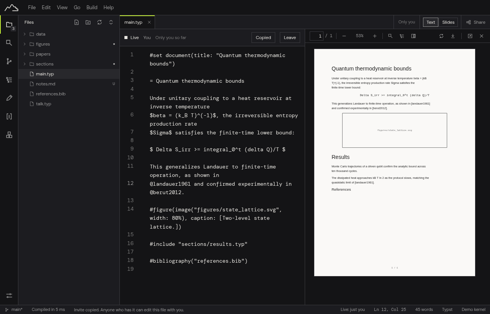

# Edit Together Live

Edit one file or a whole project with other people at the same time, see their carets, and keep an end-to-end encrypted session that the relay cannot read.

Live editing lets two or more people type in the same text file at the same time and see each other's edits and carets as they happen. You can share **one file** or the **whole project**. In a whole-project session everyone also sees files appear, move and disappear, and images, figures and PDFs are shared too (with limits, see [Limits of whole-project sessions](#limits-of-whole-project-sessions)).

Your files on disk stay ordinary files. The shared state lives in memory while the session runs, plus a disposable copy in Manang's data folder. When you press `Ctrl+S` (`Cmd+S`), Manang saves exactly what you see; nothing about the session is written into your project except the files themselves (and, if something is replaced or deleted, a copy in the project's trash, see [Whole-project sessions](#whole-project-sessions)).

## What you need

- **A relay**, to start a session. Manang uses the relay run by Fundaments (`wss://relay.fundaments.work`) unless you change it. A relay is a small server where the people in a session meet. It passes on encrypted data and cannot read your text (see [What the relay can see](#what-the-relay-can-see)). If you were given a different relay address, paste it into Settings > Collaboration > Relay address.
- **An invite**, to join a session. The person who shares the file sends it to you. It already contains the relay address, so you do not need to set one to join.

## The Share button

Everything about working with other people is behind one button: **Share**, at the right end of the tab strip (`Ctrl+Alt+L`, `Cmd+Option+L`; on narrow windows it shows only its icon). It opens a small panel with:

- **Edit together live**: share the open file, or join with an invite.
- **Invite link** and **Leave live session**, while a session is running.
- **Participants and Follow**, while a session runs: pick **Follow** next to a person to follow where they work (it only moves your view; **Stop following** ends it).
- **Share versions**: send your saved versions to co-authors and get theirs (see [Share and get updates](share-and-get-updates.md)).



The same actions are in the **File** menu and the command palette. Escape closes the panel and puts you back where you were.

While you are in a session you also see:

- the other people as small marks (their initials and a coloured underline) at the right of the tab strip, with the full name when you hover;
- a **Live: 2 people** item in the status bar, which opens the Share panel (it says *connecting*, *reconnecting* or *stopped* when the connection is not up);
- the session bar above the editor.

When you are not in a session, none of these is shown.

## The relay (to share)

Sharing works out of the box: **Relay address** in Settings > Collaboration starts as `wss://relay.fundaments.work`, the relay Fundaments runs. It only passes on encrypted data and cannot read your text (see [What the relay can see](#what-the-relay-can-see)).

If you were given a different relay address, enter it under **Relay address**. To turn sharing off, empty the field; the Share panel then says *Set a relay in Settings* and has an **Open Settings** button. Joining never needs the setting, because the invite carries the address.

## Share a file

1. Open the text file you want to work on together.
2. Press **Share**, make sure **This file** is chosen, then **Share this file**. (Or use **File > Share this file live…**, or the command palette, `Ctrl+K`.)
3. A bar appears above the editor. It says **Connecting**, then **Live** once it is connected. The invite has been copied to your clipboard. If the clipboard is not available, the invite appears in a field in the bar, already selected.
4. Send the invite to the people you want to work with. Use **Copy invite** in the bar to copy it again.

An invite is a long link that starts with `manang-live://`. **Anyone who has it can edit the file with you**, so send it only to the people you mean, through a channel you trust.

## Whole-project sessions

To work on a whole thesis or paper, press **Share**, choose **Whole project**, and share. Everyone who joins gets the host's files and sees every file that is created, renamed, moved or deleted in the session. Open files show who else is in them, with a small coloured mark on the tab and in the file list.

**What is shared.** Every file in the project folder, except:

- files and folders whose name starts with a dot (so `.git`, `.env`), `manang.toml`, and the `.manang` folder;
- folders named `target`, `node_modules` or `__pycache__`;
- anything your project's `.gitignore` ignores;
- links to other places (shortcuts, symbolic links), and files over 64 MiB.

These rules apply on both sides. The same rules keep other people from creating such files on your disk.

**Everyone with the invite can change your files.** In a whole-project session, anyone with the invite can create, change, rename and delete shared files on your computer, inside the project folder. They cannot reach anything outside it. Send the invite only to people you would let edit the project.

**Nothing is deleted for good.** A file deleted in the session, or replaced by someone else's version, is first moved to the project's trash (the folder `.manang/trash` inside your project). Leaving the session never deletes your files.

### Join a whole-project session

1. Press **Share** and choose **Join with an invite**, then paste the invite. Joining needs an open project folder, because the files are written into it (create an empty folder and open it if you want a clean copy).
2. Manang connects and fetches the list of the host's files. Nothing on your disk changes yet.
3. The **Join the shared project** dialog shows how your files compare with the host's:
   - **Different on your disk**: files that exist on both sides with different content. For each, choose **Use the host's** (your copy goes to the trash and is replaced) or **Keep mine** (the file stays out of the session on your side: it is never sent, never overwritten and not listed). If more than one file would be replaced, tick the single confirmation (**Replace N of my files with the host's versions**). Without it, the **Join** button stays off.
   - **Only on your disk**: files the host does not have. They stay private unless you choose **Share it**.
   - **New for you** and **The same on both sides**: nothing to decide. New files are added to your project; identical files are left alone.
4. Press **Join**. Files arrive in the background, the status bar shows progress, and the files you have open are fetched first.

If the host is not there, the bar says **Waiting for host**, and nothing changes until someone answers.

### A large rewrite on your disk

If many files change at once on your disk while you are in the session, for example after a Git checkout (more than 25 files at once, or more than half the lines of the changed text files), Manang does not send them. A **Changes on hold** button appears in the status bar and a window called **Many files changed at once** asks:

- **Share these changes** sends them to everyone.
- **Put my folder back** restores your folder to what the session has. The copies you have now go to the trash.
- **Decide later** keeps the changes held; the **Changes on hold** button in the status bar opens the question again.

Smaller edits made with other programs, such as saving a file in another editor, are shared as ordinary edits.

### Leaving as the host

If you started the session and press **Leave** while some files have not reached anyone else, Manang warns you: *N files have not reached anyone else yet. If you leave now, the others will not have them. Nothing on your disk is deleted.* The window is called **Leave the session?**. **Stay** keeps the session; **Leave anyway** ends it. The warning never blocks you.

### Limits of whole-project sessions

- **Images, figures and other non-text files: last writer wins.** If two people change the same image or figure at nearly the same time, one version replaces the other. Text files merge edit by edit as usual.
- **Text files over 8 MiB** are treated like images (last writer wins).
- **A session needs someone in it.** When everyone has left, the session is gone: you cannot join an empty room, and an invite to it does not bring anything back. Keep your own copy (the files on your disk are yours); to continue, someone starts a new session and shares a new invite.
- **Nobody can be removed from a session.** To stop sharing with someone, leave and start a new session; the old invite then does nothing.
- **Names are claims.** There are no accounts, and every member has the same rights: nobody can be set to read-only.
- **Case-only differences** (`Fig.png` and `fig.png`) are refused on Windows and macOS when they would collide with an existing file. This has been tested on Linux only.
- **Closing a file's tab** in a whole-project session does not leave the session. **Leave** does.
- A file the host's computer saved but nobody else has opened can briefly lag: its latest text reaches others about a second and a half after typing stops.

## Try it on one computer

You can test live editing with two windows on the same computer. The windows still use the relay set in Settings.

1. Share a file as above and copy the invite.
2. Start a second copy of Manang with its own settings folder, and allow a second instance (normally a second launch just brings the first window forward):

   ```
   MANANG_MULTI_INSTANCE=1 XDG_CONFIG_HOME=$HOME/.manang-second/config XDG_DATA_HOME=$HOME/.manang-second/data XDG_CACHE_HOME=$HOME/.manang-second/cache manang
   ```

3. Open a copy of the project in it (a different folder, or the same file opened there), choose **Share > Join with an invite** and paste the invite. Joining needs no relay setting: the address is in the invite. Both windows now show each other's cursors.

## Join a session

1. Press **Share** and choose **Join with an invite** (or use **File > Join a live session…**).
2. Paste the invite and press `Enter`.
3. Manang opens the file the invite names if your project has it; otherwise it uses the file in front of you.

If your copy of the file is **identical** to the host's at the moment they started sharing, you join straight away.

If it is **different**, Manang does not replace anything silently. It asks first, and explains that joining replaces your copy with the host's version. If you agree, your copy is saved first to a folder outside your project (`live-trash` in Manang's settings folder). Your file is replaced only when someone in the session actually answers; until then the bar says **Waiting for host** and your file stays as it is (you cannot type in it meanwhile). If your copy is empty, there is nothing to lose and you join directly.

If nobody answers within about 20 seconds, the bar says so and keeps trying. Check that the host still has the session open, or press **Re-sync** to ask again.

If everyone left a session and you open the same invite again with the file unchanged since, Manang restores the document from a private copy it keeps in its data folder, so nothing typed in the session is lost. If the file changed in the meantime, the file on disk wins and Manang asks as above.

## In the session

- The bar shows the state of the connection and who is in the session. Each collaborator has a name and a mark next to it; the same mark (a colour mix and a line style) is drawn at their caret in the text, with their name above it. Selections are tinted in the same colour.
- Everyone's edits merge. If two people type at the same spot at the same moment, both edits are kept.
- **Undo is yours.** `Ctrl+Z` takes back your own edits only, never someone else's.
- In a one-file session, closing the file's tab leaves the session.

### States

| The bar says | What it means |
| :--- | :--- |
| **Connecting** | Opening the connection and exchanging the document with the others. |
| **Waiting for host** | You joined, but nobody has answered yet. Your file is untouched and read-only until someone does. |
| **Live** | Connected. Edits flow both ways. |
| **Reconnecting** | The connection dropped. Keep typing: your edits are kept and merge automatically when the connection is back. Manang retries on its own, waiting a little longer each time. |
| **Session stopped** | Something went wrong; the bar says what. Many problems pass by themselves (the bar goes back to Live). **Re-sync** rebuilds your copy from the others; if that does not help, leave and join again with the invite. |

## Leave

Choose **Leave** in the bar (or **Leave live session** in the File menu). Edits still on their way get a moment to arrive, then the session ends. The file stays open as it was; save it as usual. Leaving does not delete anything for the others, who carry on.

## Saving, versions and Git

- Each person saves their own copy. After a session everyone's file contains the same merged text, but each person decides when to save it.
- Version history and Git work as before, with two rules. **Get updates** and restoring the live file are refused while you are in a session (they would rewrite the file for everyone); leave first. If another program changes the live file on disk, Manang keeps the session's text and your next save overwrites the disk copy.
- When you **save a version** during a session, the people who edited with you are credited with `Co-authored-by` lines. Manang shares your email with them only if you type one in Settings > Collaboration (*Email shared with collaborators*); people without a shared email are named in the version's message instead.

## What the relay can see

The invite contains a secret key. The key is part of the link after the `#`, so it is never sent to the relay. Everything that goes through the relay (text, file names, file contents) is encrypted with it (XChaCha20-Poly1305) before it leaves your computer.

- The relay can see: that a connection to a room exists, how large and how frequent the messages are, and when people connect and leave. A room is named by a number derived from the key; the relay cannot turn it back into the key.
- The relay cannot see: your text, your edits, your name, your caret, the file name, or the key.
- The relay stores nothing and forgets a room when the last person leaves.

What this does not give you:

- **No accounts.** Everyone holding the invite is trusted equally. A name in the bar is a claim, not a login: anyone with the invite could use another person's name.
- **No forward secrecy.** Someone who obtains the invite later and recorded the encrypted traffic earlier could read it. To rotate the key, leave and start a new session.
- The relay operator can see the *metadata* above. If that is not acceptable for a project, do not share it live: share versions with Git instead (see [Share and get updates](share-and-get-updates.md)).

## Troubleshooting

- **"Set a relay in Settings to share live."** Sharing needs a relay address (joining does not). See [Set the relay](#the-relay-to-share).
- **"This invite is not valid."** The link was cut or changed. Ask for it again and paste it whole, including everything after the `#`.
- **Stuck on Connecting or Reconnecting.** The relay is not reachable from your network (firewall, wrong address, relay down). Check the address in Settings; the person who shared can see the same state in their bar. Your edits are kept in the meantime.
- **"The live document was re-read from the session."** A step could not be applied, so Manang replaced your view with the session's text to stay consistent. Edits you had typed in the last moments before may need to be typed again. This is rare; please report it.
- **Both people see different text after reconnecting.** Manang normally notices and re-syncs by itself. If the bar says **Session stopped** or **Waiting for host**, press **Re-sync**. If it keeps happening, please report it with the relay address kind (`ws://` or `wss://`) and what you were doing.
