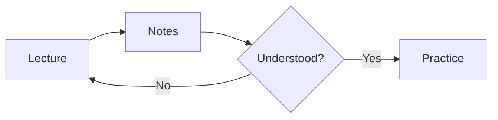

# Take Lecture Notes in Markdown with Math

Take lecture notes with Manang's Notes (Markdown) template: headings, math, code, task lists and diagrams, a live preview, and a route to PDF through Typst.

Markdown is plain text, so notes stay small, searchable and easy to keep under version control. Manang's **Notes (Markdown)** template gives you a starting page with a summary, a diagram and a to-do list. This page covers what the template contains, how to write math, code and diagrams in it, what the preview shows, and what to do when you need a PDF, because in this beta a Markdown file has no PDF export of its own.

## How do I start a notes project?

1. On the Home screen click **Templates**, then **Use template** on **Notes (Markdown)**. (Or choose **File > New project** and pick it from the **Template** list.)
2. Enter a **Project name**, for example `physics-lectures`, choose a folder under **Create in**, and click **Create project**.
3. Manang creates `index.md` and `manang.toml` and opens `index.md` with the live preview. See [Templates](templates.md).

The template has no bibliography file and no images. Its `index.md` starts with the project name as the `#` heading, then three sections:

- **Research Summary**, one sentence of sample text.
- **Process Flow**, a `mermaid` code block that draws a small flowchart (literature review, hypothesis, experimentation, analysis, publication).
- **Action Items**, a task list with two ticked and one open item.

All of that is sample content. Replace it with your own headings. To keep one file per lecture, add files such as `lecture-01.md` in the Files panel; for Markdown every file previews itself, so each page shows the file you are editing.

## What Markdown can I use?

Manang reads CommonMark with the common GitHub-style extensions turned on: tables, task lists, strikethrough, footnotes, heading attributes and `$` math. The rules for the GFM extensions are in the [GitHub Flavored Markdown spec](https://github.github.com/gfm/).

````markdown
## Lecture 3: Entropy

### Key ideas

- Entropy never decreases in an isolated system.
- **Bold** for terms, *italic* for emphasis, ~~strike~~ for corrections.

> Exam hint: be ready to derive the Clausius inequality.

| Quantity | Symbol | Unit |
| :--- | :---: | :--- |
| Entropy | S | J/K |
| Heat | Q | J |

- [x] Read chapter 4
- [ ] Do problem set 2
````

Use `#` to `######` for headings; the outline panel lists them. Front matter between `---` lines is accepted and hidden in the preview. Raw HTML is not displayed as HTML in the preview: it is shown as escaped text for safety, so use Markdown syntax instead.

## How do I write math?

Put inline math between single dollar signs and display math between double dollar signs:

```markdown
The energy is $E = mc^2$, and the entropy change obeys

$$
\Delta S \ge \int_0^t \frac{\delta Q}{T}
$$
```

The formula is written in LaTeX notation. What you see depends on where you look:

- **Source mode** shows the dollar-sign text.
- **The formatted preview** (the Markdown preview beside the editor) shows each formula as its source text between dollar signs. As far as the source shows, the preview in this beta does not typeset math (from the code: `crates/manang-markdown/src/html.rs` marks the formula and no step in the app draws it).
- **The Visual editor** draws formulas typeset, as LaTeX math, while you write. Switch with `Ctrl+Alt+V` (`Cmd+Option+V`) or **View > Visual editor**, and back to **Source** at any time; the file stays plain text either way. See [The Visual Editor](visual-editor.md).
- **After conversion to Typst** and PDF export, formulas are typeset by Typst, but see the limits below.

Spell check skips math. The editor also offers math symbol completion; see [Writing](writing.md#5-insert-snippets-and-math-symbols).

## How do I add code blocks and images?

Fence code with three backticks and a language name:

````markdown
```python
def entropy(p):
    return -sum(x * log(x) for x in p if x > 0)
```
````

The preview shows it as a monospaced block. Inline code uses single backticks. Fence languages `mermaid`, `pikchr`, `bob` and `svgbob` are special: they become diagrams (next section).

Add an image with ``, with the file inside the project folder. You can draw a figure in Manang's figure studio and copy the line to paste; see [Figures and Diagrams](figures-and-diagrams.md#4-include-figures-in-documents). The Visual editor draws images in place.

## How do I draw diagrams in Markdown?

Write the diagram as text in a fenced block. The preview draws it as a picture, in the same ink-on-paper theme as the rest of the page:

````markdown

````

- `mermaid`: Mermaid syntax; the first line names the diagram type, such as `flowchart`, `sequenceDiagram`, `classDiagram`, `stateDiagram` or `gantt` ([Mermaid syntax reference](https://mermaid.js.org/intro/syntax-reference.html)). Manang draws them with its own built-in renderer rather than the Mermaid JavaScript library, so an unusual diagram type may not draw; the [Figures and Diagrams](figures-and-diagrams.md#2-write-text-diagrams) page lists what it supports.
- `pikchr`: Pikchr's PIC-like language.
- `bob` or `svgbob`: boxes and arrows drawn with ASCII characters.

If a diagram has a syntax error, the preview shows a short note in its place and the error appears in the **Problems** tab with its line number. Math inside Mermaid labels is not rendered in this beta (known limitation). Everything runs locally; nothing is uploaded. More in [Figures and Diagrams](figures-and-diagrams.md#3-fenced-diagrams-in-markdown).

## How does the live preview work?

The preview is a formatted page on the right of the editor. After a pause of 300 ms by default it updates, keeping its place; turn **Auto compile** off in Settings if you prefer to refresh with `Ctrl+Shift+B` (`Cmd+Shift+B`). `Ctrl+Shift+V` (`Cmd+Shift+V`) cycles editor and preview, editor only and preview only. See [Preview and PDF](preview-and-pdf.md#4-live-recompile). Search across notes is in [Search and Replace](search-and-replace.md), and `Ctrl+Alt+S` (`Cmd+Option+S`) saves a named version, for example *End of week 5*; see [Version History and Restore](version-history.md).

## Can I export Markdown notes to PDF?

Not directly. **Export PDF** is for Typst and LaTeX documents: in the preview header of a Markdown file the button is disabled (`PreviewPane.svelte`), and the export command only runs the Typst or LaTeX compiler. The way to a PDF is **Edit > Convert to Typst**, then exporting the Typst file. To get a PDF from your notes:

1. Open the Markdown file and choose **Edit > Convert to Typst**, or run `Convert to Typst` from the command palette (`Ctrl+K` / `Cmd+K`).
2. Manang writes `<name>.typ` next to the Markdown file (`index.md` becomes `index.typ`) and opens it. If that file already exists, Manang asks before replacing it and copies the old one to the project trash first.
3. Check the result in the Typst preview, fix what the conversion could not translate (below), and press `Ctrl+E` (`Cmd+E`) to export the PDF. See [Preview and PDF](preview-and-pdf.md#5-export-pdf).

The conversion is one way and does not update later. Your Markdown file is not changed, and edits you make in the `.typ` file do not flow back, so convert again (and replace) when the notes change, or continue in Typst.

### What does the conversion translate, and what does it not?

From the converter's code (`crates/manang-markdown/src/typst.rs`) and its tests:

- **Translated:** headings (`#` becomes `=`, `##` becomes `==`), paragraphs, bold, italic, strikethrough, block quotes, bullet and numbered lists, code blocks and inline code, links, images (as `#image("path")`) and tables (as `#table`). The status line says how many parts could not be converted exactly.
- **Math is copied unchanged.** Typst math is not LaTeX math. A formula written with `\frac`, `\int` or `\hbar` is not translated, and Typst will report errors for it; rewrite it in Typst notation. The Article template's formula, `$ Delta S >= integral_0^t (delta Q)/T $`, shows the style, and Manang's own Typst guide writes `$E = m c^2$` with a space between letters ([Typst equation reference](https://typst.app/docs/reference/math/equation/)). Simple formulas may pass as they are.
- **Diagrams become figures.** A `mermaid`, `pikchr` or `bob` block turns into `#figure(image(...))` with the picture pointing into the project's `.manang/cache/diagrams/` folder. If there is no project, or the diagram has an error, it stays a code block and a warning names its line. The cache folder is Manang's local state and a new project's `.gitignore` ignores it, so share or archive the SVG files if you need them elsewhere.
- **Dropped or approximated:** front matter is left out; raw HTML is omitted with a warning; table column alignment is not carried over; image alt text is not turned into a caption, and task-list ticks become plain `[x]` and `[ ]` text; footnotes are not converted faithfully.

Typst's own syntax for the result is in [Using Manang as a Local Typst Editor](typst-editor.md), and [Move from LaTeX to Typst](move-from-latex-to-typst.md) helps with the math notation.

## A short routine for lectures

1. Create one project per course, one file per lecture.
2. During the lecture, write headings and bullet points; add `$...$` formulas without worrying about layout.
3. After the lecture, add a diagram or a table and tick the action items.
4. Save a version at the end of each week.
5. Before an exam, convert the files you need to Typst, fix the math, and export a PDF to print.

## Sources

- [GitHub Flavored Markdown spec](https://github.github.com/gfm/): tables (4.10), task list items (5.3) and strikethrough (6.5) are extensions to CommonMark.
- [Mermaid syntax reference](https://mermaid.js.org/intro/syntax-reference.html): a diagram starts with a line naming its type; the diagram types named above.
- [Typst equation reference](https://typst.app/docs/reference/math/equation/): inline and block math in Typst.

Last checked: October 2026.
