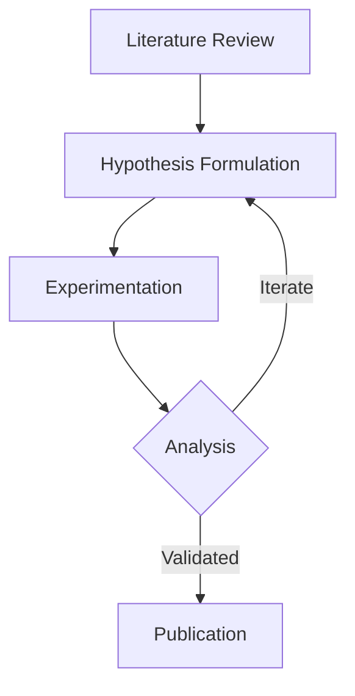

# {{title}}

## Research Summary

Structured research notes documenting workflow, experimental architecture, and key findings.

## Process Flow

## Action Items

- [x] Verify offline compilation of starters
- [x] Integrate Mermaid workflow fences
- [ ] Document benchmark parameters
