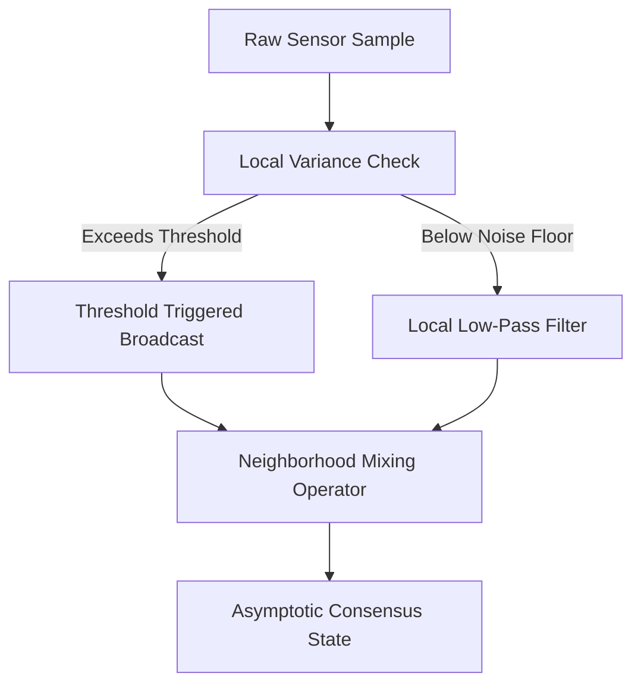

# Research Notes: Nonequilibrium State Transitions

Notes on decentralized communication complexity and thermodynamic bounds.

## Mathematical Formulation

The transition probability density $W(x \to x')$ between discrete operational states satisfies detailed balance under thermal equilibrium:

$$P(x) W(x \to x') = P(x') W(x' \to x)$$

When driven out of equilibrium by an external time-dependent protocol $\lambda(t)$, the dissipated work $W_{\text{diss}} = W - \Delta F$ satisfies the non-equilibrium fluctuation theorem:

$$\langle e^{-\beta W_{\text{diss}}} \rangle = 1$$

where $\beta = (k_B T)^{-1}$ represents the inverse ambient temperature.

## Pipeline Architecture

The state reconciliation and event-driven update cycle follows this directed workflow:

## Summary Table

| Parameter | Symbol | Default Value | Units |
| :--- | :--- | :--- | :--- |
| Temperature | $T$ | 300 | K |
| Damping Coefficient | $\gamma$ | 1.0 | $\text{kg} \cdot \text{s}^{-1}$ |
| Diffusion Constant | $D$ | $4.14 \times 10^{-21}$ | $\text{J}$ |
| Cooling Rate | $\lambda$ | 0.005 | $\text{step}^{-1}$ |

The experimental runs confirm that event-driven triggering reduces total communication packets by over 70% while maintaining sub-millimeter positioning precision.
